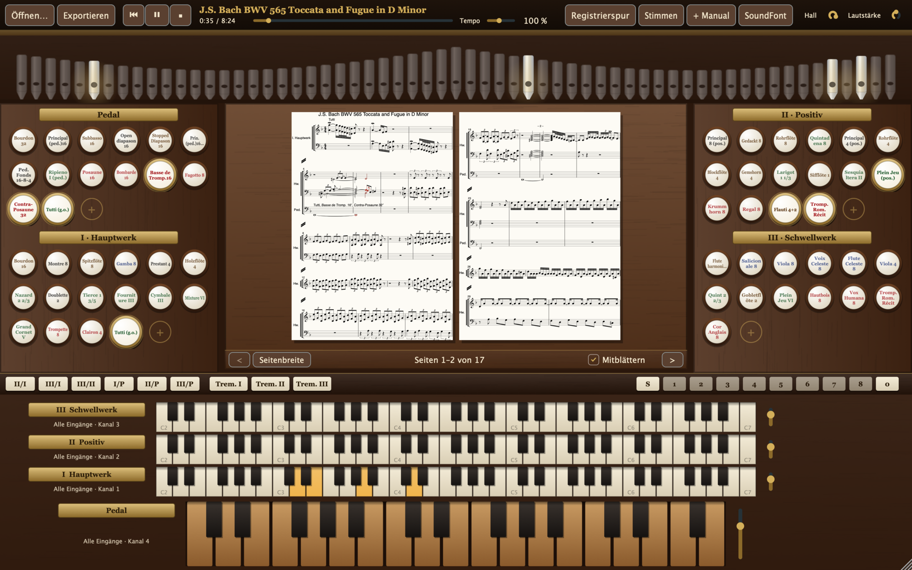
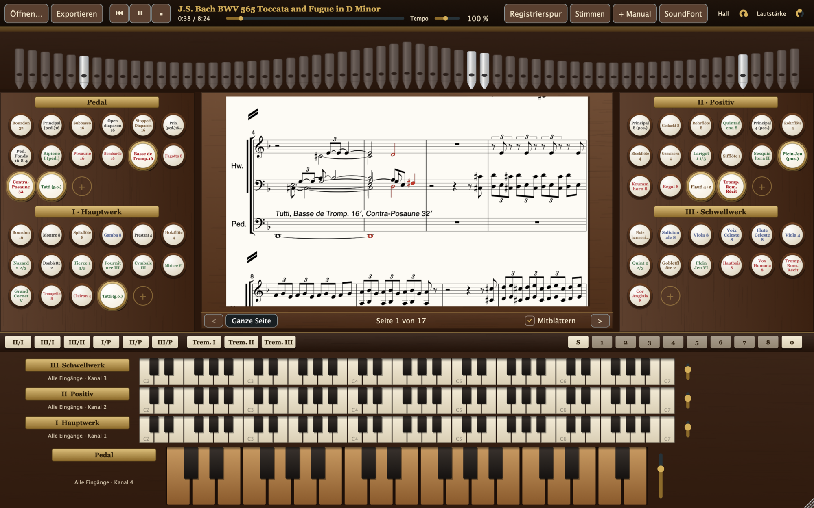

# Orgelwerk

Pfeifenorgel als eigenständige App (macOS, Windows, Linux) und als Plugin für DAWs
(VST3 überall, Audio Unit auf dem Mac, LV2 unter Linux). Der Klang kommt aus einer
SF2-SoundFont (eingebaut: **Jeux14**), die Noten stehen auf dem Notenpult in der Mitte.





## Was die Orgel kann

- **Spieltisch**: Pfeifenprospekt, Registerzüge links und rechts (Klick = ziehen/abstoßen,
  Rechtsklick = verschieben/entfernen, „+“ = beliebigen Klang aus der SF2 als Register
  hinzufügen), Manuale I–III und Pedal, weitere Manuale über **+ Manual**.
- **Koppeln** (II/I, III/I, I/P …) und **Setzer**: `S` und dann eine Nummer speichert die
  Registrierung, eine Nummer ruft sie ab, `0` stößt alles ab.
- **MIDI**: Jedes Manual und das Pedal hat einen eigenen Eingang. Klick auf das Namensschild
  links neben der Tastatur: MIDI-Gerät (in der App jedes angeschlossene Gerät einzeln, im
  Plugin der DAW-Eingang), Kanal (Omni oder 1–16), **MIDI lernen**, Lautstärke, Manual
  entfernen. CC 7/11 wirkt als Schwellpedal. Voreinstellung: Manual I = Kanal 1,
  II = 2, III = 3, Pedal = 4.
- **Notenpult**: zeigt die Partitur (1 oder 2 Seiten, „Seitenbreite“ rollt die Seiten
  durchgehend und hält die gespielte Zeile ganz im Bild), markiert beim Abspielen die
  klingenden Noten, blättert mit, Klick auf eine Note springt dorthin. Leertaste =
  Start/Pause, Pfeiltasten = ±5 s.
- **Notenbild wie Orgelausgaben**: eigene Systeme je Manual und Pedal (leere werden pro Zeile
  ausgeblendet; klassisch mit drei Systemen unter „Ansicht“), Registrierung aus der Datei als
  Text, Werkkürzel (Hw., Pos., Sw.) bei Manualwechseln, Triolen, Triller und Mordente.
- **Stimmen**: legt fest, welche Stimme des Stücks auf welchem Manual/Pedal spielt.
  Verdoppelte Kanäle in Orgel-MIDI-Dateien (ein Kanal pro Register) werden erkannt und als
  Registrierung gezogen; Programmwechsel mitten im Stück wechseln die Register dieses Werks.
- **Instrumente als Register**: in normalen General-MIDI-Dateien wird jedes Instrument auf
  passende Orgelregister gelegt (Klavier → Prinzipal 8′ + 4′, Streicher → Gambe + Schwebung,
  Flöte → Flöten, Trompete → Trompete 8′, Oboe → Hautbois, Chor → Vox humana, Bass → 16′ + 8′ …).
  Orgel-MIDI-Dateien für Jeux (Bank 42/43) ziehen weiter genau die Register, die sie angeben;
  mit einer GM-SoundFont klingen die Instrumente selbst.
- **Automatische Grundregistrierung**: spielt eine Stimme des Stücks auf einem Werk ohne
  gezogenes Register, zieht Orgelwerk dort Prinzipal 8′ + 4′ (Pedal 16′ + 8′), damit keine
  Stimme stumm bleibt (abschaltbar im Menü „Wiedergabe“).
- **Registrierspur**: Registrierung an beliebigen Stellen merken (Knopf „Registrierspur“ oder
  Taste `R`). Beim Abspielen und im Audio-Export wird dort sample-genau umgeregistriert; die
  Stellen erscheinen als goldene Marken auf der Zeitleiste und werden mit gespeichert.
- **Tremulant** pro Manual (Wippen „Trem.“ in der Koppelleiste).
- **Raumklang**: jedes Werk steht an seinem Platz (Pedal in den Seitentürmen, Hauptwerk mittig,
  Positiv nah, Schwellwerk hinten), die Pfeifen sind wie in echten Orgeln auf C- und Cis-Seite
  verteilt; Entfernung wirkt über Verzögerung, Höhendämpfung und Hallanteil. Dazu ein
  berechneter Kirchenhall (Faltung, ca. 3,6 s) und ein Limiter gegen Übersteuerung.
  Abschaltbar unter Optionen.
- **Prospekt**: die Pfeifen springen beim Anspielen hoch, bleiben groß solange ihr Ton klingt
  und leuchten.
- **Computertastatur** spielt Manual I: `A W S E D F T G Z/Y H U J K O L P`, Oktave mit `,` und `.`.

## Sprachen

Deutsch, Englisch, Französisch, Spanisch, Italienisch und Niederländisch. Orgelwerk startet in
der Sprache des Systems (sonst Englisch); unter **Ansicht → Sprache** lässt sie sich festlegen
(gilt ab dem nächsten Start). Die Texte stehen in `resources/lang/*.json`.

## Notenformate

| Import | Export |
| --- | --- |
| MIDI (.mid .midi .kar .smf .rmi) | MIDI (mit Registrierung als Kanäle) |
| MusicXML (.musicxml .xml .mxl) | MusicXML, MusicXML komprimiert (.mxl) |
| MEI | MEI |
| ABC | ABC |
| Humdrum **kern (.krn .hum) | Humdrum **kern |
| Plaine & Easie, GABC, MuseData, EsAC, CMME | LilyPond (.ly) |
| über MuseScore (falls installiert): .mscz .mscx, Guitar Pro, Capella, Overture, PowerTab, Bagpipe, Band-in-a-Box | PDF, SVG, PNG (Notenseiten) |
| | MuseScore .mscz (über MuseScore) |
| | **Audio über die SF2**: WAV, AIFF, FLAC, Ogg Vorbis |

MIDI-Dateien werden für das Notenbild quantisiert (Takte, Stimmen, Haltebögen, Vorzeichen,
Balken; die Tonart wird geschätzt, wenn die Datei nur C-Dur angibt). Notendateien
(MusicXML, MEI …) werden so gezeigt, wie sie notiert sind.

## Bauen

Voraussetzungen: CMake ≥ 3.22, ein C++20-Compiler, Ninja (empfohlen). Unter Linux zusätzlich
die JUCE-Abhängigkeiten (siehe `.github/workflows/build.yml`).

```bash
git submodule update --init --recursive
cmake -S . -B build -G Ninja -DCMAKE_BUILD_TYPE=Release
cmake --build build
```

Ergebnisse liegen in `build/Orgelwerk_artefacts/Release/` (Standalone, VST3, AU, LV2).
`orgelcli` ist ein Kommandozeilenwerkzeug für Tests:

```bash
build/orgelcli_artefacts/Release/orgelcli info stueck.mid
build/orgelcli_artefacts/Release/orgelcli export stueck.mid stueck.musicxml stueck.pdf stueck.wav
```

Die App öffnet eine Notendatei auch direkt beim Start: `Orgelwerk stueck.mid`.

## Bibliotheken

- [JUCE 8](https://juce.com) – App- und Plugin-Gerüst (AGPLv3 oder kommerzielle Lizenz)
- [Verovio 6.4](https://www.verovio.org) – Notensatz und Notenformate (LGPLv3)
- [TinySoundFont](https://github.com/schellingb/TinySoundFont) – SF2-Wiedergabe (MIT)
- **Jeux 1.4** (`resources/Jeux14.sf2`) – Orgel-SoundFont von John W. McCoy, Long Beach (CA),
  © 2000, <https://www.realmac.info/download.htm> (auch bei HammerSound). Laut Autor darf die Datei
  frei weitergegeben werden, aber **ohne schriftliche Erlaubnis des Autors nicht kommerziell
  genutzt werden**. Damit ist auch Orgelwerk mit eingebauter Jeux-SoundFont nur für
  nichtkommerzielle Zwecke gedacht; eine andere SF2 lässt sich über **SoundFont** laden.
  Siehe [LIZENZEN.md](LIZENZEN.md).

## Lizenz

Orgelwerk ist freie Software unter der **GNU Affero General Public License, Version 3**
(siehe [LICENSE](LICENSE)). Copyright © 2026 Domenik Cloke.

Die eingebaute SoundFont Jeux 1.4 steht nicht unter der AGPL, sondern unter den Bedingungen
ihres Autors: frei weitergeben ja, kommerziell nutzen nur mit seiner schriftlichen Erlaubnis.
Einzelheiten zu allen Bestandteilen stehen in [LIZENZEN.md](LIZENZEN.md).
